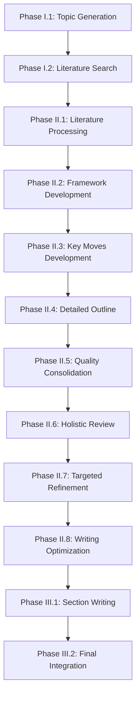

# Architecture Guide

This guide provides a comprehensive overview of the Philosophy Pipeline's architecture, design patterns, and technical implementation.

## System Overview

The Philosophy Pipeline is a sophisticated multi-phase system that generates publication-ready philosophical papers using large language models. The architecture is designed for modularity, extensibility, and robust error handling.

### High-Level Architecture

```
┌─────────────────────────────────────────────────────────────────┐
│                    Philosophy Pipeline                          │
├─────────────────────────────────────────────────────────────────┤
│                                                                 │
│  ┌─────────────┐  ┌─────────────┐  ┌─────────────────────────┐  │
│  │   Phase I   │  │  Phase II   │  │      Phase III          │  │
│  │   Topic     │  │  Framework  │  │      Writing           │  │
│  │ Development │  │    & Key    │  │   & Integration        │  │
│  │             │  │   Moves     │  │                        │  │
│  └─────────────┘  └─────────────┘  └─────────────────────────┘  │
│                                                                 │
├─────────────────────────────────────────────────────────────────┤
│                    Core Components                              │
├─────────────────────────────────────────────────────────────────┤
│                                                                 │
│  ┌─────────────┐  ┌─────────────┐  ┌─────────────────────────┐  │
│  │ Pipeline    │  │ Configuration│  │     Monitoring         │  │
│  │ Runner      │  │   Manager    │  │   & Profiling          │  │
│  └─────────────┘  └─────────────┘  └─────────────────────────┘  │
│                                                                 │
│  ┌─────────────┐  ┌─────────────┐  ┌─────────────────────────┐  │
│  │   Output    │  │ Performance  │  │    API Integration     │  │
│  │  Manager    │  │ Optimization │  │   (Anthropic/OpenAI)   │  │
│  └─────────────┘  └─────────────┘  └─────────────────────────┘  │
│                                                                 │
└─────────────────────────────────────────────────────────────────┘
```

## Core Components

### 1. Pipeline Runner (`src/pipeline/`)

The central orchestration component responsible for:

- **Phase Execution**: Managing the execution order and dependencies
- **State Management**: Tracking pipeline state across phases  
- **Error Recovery**: Handling failures and retry mechanisms
- **Resource Management**: Managing API rate limits and memory usage

#### Key Classes

```python
class PipelineRunner:
    """Main pipeline orchestration"""
    def __init__(self, config_path: str = None)
    def run_full_pipeline(self, dev_mode: bool = False) -> bool
    def run_phase(self, phase_id: str, dev_mode: bool = False) -> bool
    def get_pipeline_status(self) -> Dict[str, Any]
    def validate_environment(self) -> Dict[str, bool]

class PhaseRegistry:
    """Phase discovery and metadata management"""
    def discover_phases(self) -> Dict[str, PhaseMetadata]
    def get_phase_metadata(self, phase_id: str) -> PhaseMetadata
    def validate_dependencies(self, phase_id: str) -> bool
```

### 2. Phase Architecture (`src/phases/`)

Each phase is implemented as a self-contained module with standardized interfaces:

#### Phase Structure
```
src/phases/
├── core/                    # Base classes and interfaces
│   ├── base_worker.py      # Abstract worker base class
│   ├── base_workflow.py    # Workflow orchestration  
│   └── exceptions.py       # Phase-specific exceptions
├── phase_one/              # Topic development
├── phase_two/              # Framework & content development
└── phase_three/            # Writing & integration
```

#### Worker Pattern

All phases implement the standardized Worker pattern:

```python
class BaseWorker(ABC):
    """Abstract base class for all workers"""
    
    @abstractmethod
    def execute(self, context: WorkerContext) -> WorkerResult:
        """Execute the worker's main functionality"""
        pass
    
    def validate_inputs(self, context: WorkerContext) -> bool:
        """Validate required inputs"""
        pass
        
    def cleanup(self) -> None:
        """Cleanup resources after execution"""
        pass
```

#### Worker Types

1. **Development Workers**: Generate content (abstracts, key moves, outlines)
2. **Critique Workers**: Evaluate and provide feedback on generated content
3. **Refinement Workers**: Improve content based on critique feedback
4. **Integration Workers**: Combine and synthesize multiple components

### 3. Configuration System (`src/config/`)

Hierarchical configuration management with environment-specific overrides:

#### Configuration Structure
```yaml
api:                    # API provider settings
  anthropic:           # Claude configuration
  openai:              # OpenAI configuration

phases:                 # Phase-specific settings
  phase_1:             # Topic development config
  phase_2:             # Framework development config  
  phase_3:             # Writing configuration

models:                 # Model selection and parameters
  default:             # Default model settings
  specialized:         # Phase-specific overrides

quality:               # Quality control settings
  heuristics:          # Hájek heuristics configuration
  standards:           # Analysis journal standards

pipeline:              # Pipeline-wide settings
  output:              # Output management
  monitoring:          # Logging and monitoring
```

#### Configuration Classes

```python
class ConfigurationManager:
    """Manages configuration loading and validation"""
    def load_config(self, config_path: str) -> Dict[str, Any]
    def validate_config(self, config: Dict[str, Any]) -> bool
    def get_phase_config(self, phase_id: str) -> Dict[str, Any]
    def get_model_config(self, phase_id: str = None) -> Dict[str, Any]

class ConfigurationValidator:
    """Validates configuration schemas"""
    def validate_schema(self, config: Dict[str, Any]) -> List[str]
    def validate_api_keys(self, config: Dict[str, Any]) -> bool
```

### 4. Monitoring & Performance (`src/monitoring/`)

Comprehensive monitoring system for production deployments:

#### Components

```python
class PerformanceProfiler:
    """Profile performance metrics"""
    def start_session(self, name: str) -> str
    def end_session(self, session_id: str) -> ProfileSession
    def get_system_metrics(self) -> Dict[str, Any]

class CostTracker:  
    """Track API usage and costs"""
    def start_session(self, name: str) -> None
    def log_api_call(self, provider: str, model: str, tokens: int, cost: float)
    def get_budget_status(self) -> Dict[str, Any]

class ProgressTracker:
    """Track execution progress"""
    def create_progress(self, name: str, description: str, total: int)
    def update_progress(self, name: str, current: int)
    def complete_progress(self, name: str, success: bool)
```

### 5. Output Management (`src/outputs/`)

Structured output management with archiving and export capabilities:

```python
class OutputManager:
    """Manages pipeline outputs"""
    def save_phase_output(self, phase_id: str, data: Any) -> Path
    def load_phase_output(self, phase_id: str) -> Any
    def archive_current_run(self) -> bool
    def export_final_paper(self, format: str) -> Path
    def get_run_statistics(self) -> Dict[str, Any]
```

## Design Patterns

### 1. Command Pattern

The CLI implements the Command pattern for operation encapsulation:

```python
class Command(ABC):
    @abstractmethod
    def execute(self, args: Namespace) -> int:
        pass

class RunCommand(Command):
    def execute(self, args: Namespace) -> int:
        # Implementation
        pass
```

### 2. Strategy Pattern

Model selection and API integration use the Strategy pattern:

```python
class APIProvider(ABC):
    @abstractmethod
    def generate_response(self, prompt: str, **kwargs) -> str:
        pass

class AnthropicProvider(APIProvider):
    def generate_response(self, prompt: str, **kwargs) -> str:
        # Anthropic implementation
        pass

class OpenAIProvider(APIProvider):
    def generate_response(self, prompt: str, **kwargs) -> str:
        # OpenAI implementation
        pass
```

### 3. Observer Pattern

Progress tracking and monitoring use the Observer pattern:

```python
class ProgressObserver(ABC):
    @abstractmethod
    def on_phase_start(self, phase_id: str) -> None:
        pass
    
    @abstractmethod
    def on_phase_complete(self, phase_id: str, success: bool) -> None:
        pass

class ConsoleProgressObserver(ProgressObserver):
    def on_phase_start(self, phase_id: str) -> None:
        print(f"Starting {phase_id}...")
```

### 4. Factory Pattern

Worker creation uses the Factory pattern:

```python
class WorkerFactory:
    @staticmethod
    def create_worker(worker_type: str, phase_id: str) -> BaseWorker:
        if worker_type == "development":
            return DevelopmentWorker(phase_id)
        elif worker_type == "critique":
            return CritiqueWorker(phase_id)
        # etc.
```

## Data Flow Architecture

### 1. Phase Dependencies



### 2. Data Persistence

Each phase persists its outputs in structured formats:

```
outputs/
├── current/                    # Current run outputs
│   ├── phase_1/
│   │   ├── final_selection.json
│   │   └── literature_readings.json
│   ├── phase_2/
│   │   ├── framework_development/
│   │   ├── key_moves_development/
│   │   └── detailed_outline/
│   └── phase_3/
│       ├── phase_3_1_draft.md
│       └── final_paper.md
└── archive/                    # Archived runs
    └── 2025-08-26T14-30-15/   # Timestamped archives
```

### 3. Context Propagation

Context flows between phases through structured data objects:

```python
@dataclass
class PhaseContext:
    """Context passed between phases"""
    phase_id: str
    inputs: Dict[str, Any]
    config: Dict[str, Any]
    metadata: Dict[str, Any]
    
@dataclass  
class WorkerResult:
    """Result returned by workers"""
    success: bool
    data: Any
    metadata: Dict[str, Any]
    errors: List[str]
```

## Quality Control Architecture

### 1. Multi-Stage Validation

Quality control is implemented at multiple levels:

1. **Input Validation**: Validate inputs before processing
2. **Process Validation**: Monitor execution for anomalies  
3. **Output Validation**: Validate outputs meet quality standards
4. **Heuristic Testing**: Apply Hájek heuristics for philosophical rigor
5. **Standards Compliance**: Check Analysis journal standards

### 2. Hájek Heuristics Implementation

```python
class HajekHeuristics:
    """Implement Alan Hájek's philosophical heuristics"""
    
    def extreme_case_test(self, content: str) -> HeuristicResult:
        """Test with extreme cases"""
        pass
        
    def self_undermining_test(self, content: str) -> HeuristicResult:
        """Check for self-undermining arguments"""  
        pass
        
    def counterexample_test(self, content: str) -> HeuristicResult:
        """Search for counterexamples"""
        pass
```

### 3. Analysis Journal Standards

Integration with Analysis journal writing conventions:

```python
class AnalysisStandards:
    """Analysis journal writing standards"""
    
    def check_immediate_engagement(self, intro: str) -> bool:
        """Verify immediate problem engagement"""
        pass
        
    def check_conversational_tone(self, text: str) -> bool:
        """Verify conversational rigor"""
        pass
        
    def check_example_driven(self, text: str) -> bool:
        """Verify example-driven argumentation"""
        pass
```

## Error Handling Architecture

### 1. Exception Hierarchy

```python
class PipelineError(Exception):
    """Base exception for pipeline errors"""
    pass

class PhaseError(PipelineError):
    """Phase execution errors"""
    def __init__(self, phase_id: str, message: str)

class DependencyError(PipelineError):
    """Missing dependency errors"""
    def __init__(self, phase_id: str, missing_deps: List[str])

class ConfigurationError(PipelineError):
    """Configuration validation errors"""
    pass
```

### 2. Recovery Strategies

1. **Retry Logic**: Automatic retry with exponential backoff
2. **Graceful Degradation**: Fall back to alternative approaches
3. **State Preservation**: Save progress before critical operations  
4. **User Guidance**: Provide actionable error messages

## Performance Optimization

### 1. API Optimization

- **Request Batching**: Group related API calls
- **Response Caching**: Cache frequently used responses  
- **Rate Limit Management**: Respect provider rate limits
- **Token Optimization**: Minimize token usage in prompts

### 2. Memory Management

- **Lazy Loading**: Load data only when needed
- **Stream Processing**: Process large files in chunks
- **Garbage Collection**: Explicit cleanup of large objects
- **Memory Monitoring**: Track memory usage patterns

### 3. Disk I/O Optimization

- **Async I/O**: Non-blocking file operations
- **Compression**: Compress archived outputs
- **Batch Writes**: Group multiple write operations
- **Index Caching**: Cache file indices for fast access

## Testing Architecture

### 1. Test Structure

```
tests/
├── unit/                   # Unit tests for individual components
├── integration/            # Integration tests for phase interactions
├── end_to_end/            # Complete pipeline tests
└── fixtures/              # Test data and mocks
```

### 2. Test Categories

1. **Unit Tests**: Test individual workers and components
2. **Integration Tests**: Test phase interactions and data flow
3. **End-to-End Tests**: Test complete pipeline execution
4. **Performance Tests**: Validate performance requirements
5. **Quality Tests**: Validate output quality standards

### 3. Mock Strategy

Mock external dependencies for reliable testing:

```python
class MockAPIProvider(APIProvider):
    """Mock API provider for testing"""
    def generate_response(self, prompt: str, **kwargs) -> str:
        return self._generate_mock_response(prompt)
```

## Deployment Architecture

### 1. Local Development

- Development configuration with lower iteration limits
- Local file storage for outputs
- Console logging for immediate feedback
- Sample data for quick testing

### 2. Production Deployment

- Production configuration with full quality checks
- Cloud storage integration for outputs
- Structured logging with JSON format
- Comprehensive monitoring and alerting

### 3. Scalability Considerations

- **Horizontal Scaling**: Parallel phase execution where possible
- **Resource Pooling**: Shared API clients and connections
- **Load Balancing**: Distribute requests across multiple providers
- **Caching Strategy**: Multi-level caching for performance

## Extension Points

### 1. Adding New Phases

1. Create phase directory: `src/phases/phase_X/`
2. Implement required workers (development, critique, refinement)
3. Add phase metadata to registry
4. Update configuration schema
5. Add integration tests

### 2. Adding New Models

1. Implement `APIProvider` interface
2. Add provider configuration
3. Update model selection logic
4. Add provider-specific optimizations
5. Test with existing phases

### 3. Adding New Quality Standards

1. Implement quality checker class
2. Add configuration options
3. Integrate into quality control pipeline
4. Add validation tests
5. Update documentation

## Security Considerations

### 1. API Key Management

- Environment variable storage
- Encrypted configuration files
- Key rotation support
- Access logging

### 2. Data Privacy

- Local processing when possible
- Secure API communication
- Data retention policies
- User consent management

### 3. Input Validation

- Sanitize user inputs
- Validate configuration files
- Check file permissions
- Monitor resource usage

This architecture provides a robust foundation for generating high-quality philosophical papers while maintaining extensibility, reliability, and performance.